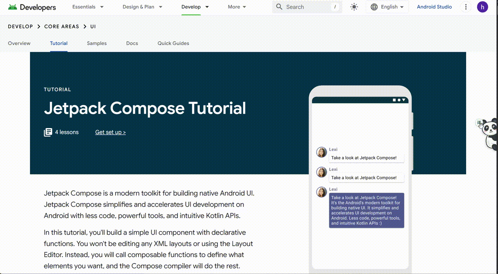
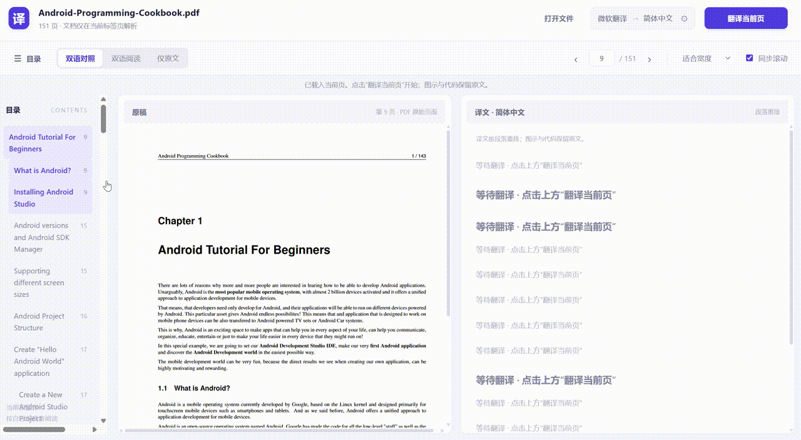

# 轻量沉浸翻译


一只可拖动、会贴边休息的黑白大熊猫，提供网页、PDF、YouTube 双语翻译，以及划词翻译与英文单词词典。支持微软免费、谷歌免费、LibreTranslate 自建服务，以及自定义 AI；各场景共用已保存的翻译引擎与目标语言。

当前版本：**0.6.0**。适用于桌面 **Chrome / Edge 125 及以上版本**。

## 功能概览

| 场景 | 入口 | 阅读方式 |
|---|---|---|
| 划词／单词 | 选中文字后，点击选区旁的小熊猫 | 句段使用随选浮卡；单词在下方显示音标、发音、词性和多义释义 |
| 普通网页 | 点击侧边熊猫，再次点击还原或取消 | 保留原文，译文显示在对应段落下方 |
| PDF | PDF 页面点击熊猫，或从工具栏选择“打开 PDF 翻译” | 双语对照、双语阅读、仅原文；两种双语模式可切换并复用当前页译文 |
| YouTube | 播放页点击熊猫、播放器“译”按钮或工具栏字幕开关 | 原文在上、译文在下，共用一个深色圆角字幕框，支持播放器全屏 |

目标语言目前提供简体中文和英文。默认使用微软免费翻译；未主动开启时不发送正文或字幕，不会自动切换翻译服务。

## 效果演示

网页双语翻译：



PDF 双语阅读：



## 安装：把插件导入 Chrome / Edge

适用于桌面 **Chrome / Edge 125 及以上版本**。直接加载即可使用，**不需要安装 Node.js、不需要编译，也不需要启动服务器**。

1. **下载并解压。** 在仓库页面下载 [安装包：沉浸式翻译.zip](dist/沉浸式翻译.zip)，解压到一个准备长期保留的文件夹，例如 `D:\浏览器插件\轻量沉浸翻译`。如果正在阅读解压包内的本文，下载与解压已完成，直接继续第 2 步。也可以下载整个仓库后解压，使用仓库中的运行文件。
2. **找到正确的文件夹。** 打开解压后的文件夹，确认其中直接包含 `manifest.json`、`src`、`assets` 和 `vendor`。如果先看到另一层文件夹，就继续进入，直到能直接看到 `manifest.json`。保留整个目录，不要只复制 HTML 文件或删除 `assets`、`vendor` 等资源。
3. **打开扩展管理页。** 在 Chrome 地址栏输入 `chrome://extensions`；Edge 输入 `edge://extensions`，按回车。
4. **开启开发者模式。** 在扩展管理页打开“开发者模式”，再点击“加载已解压的扩展程序”。
5. **选文件夹导入。** 选择第 2 步找到的、**直接包含 `manifest.json` 的文件夹**。不要选择 ZIP 压缩包、单个 `manifest.json` / HTML 文件，或仍隔着一层目录的外层文件夹。加载后应能看到“轻量沉浸翻译”扩展卡片。
6. **固定工具栏图标。** 点击浏览器工具栏的扩展菜单（拼图图标），找到“轻量沉浸翻译”，使用固定或“在工具栏中显示”选项，方便以后打开设置和 PDF 阅读器。
7. **刷新网页。** 安装前已经打开的网页需要刷新一次，侧边才会出现大熊猫；接着完成下方首次设置。

浏览器会持续读取这个解压目录，请保留它。不要在安装后移动或删除文件夹，也不要直接在压缩包内尝试加载。

## 首次设置：先用微软免费开始

1. 打开一个普通网页，点击浏览器工具栏里的插件图标，再点击 **“打开设置”**。
2. 在“翻译引擎”中选择服务。新安装默认是 **“微软免费”**，初次使用建议先保留它，**不需要注册或填写 API Key**。也可选择“谷歌免费”“LibreTranslate（自建）”或“AI 自定义”；后两者需配置自己的服务，详见后文。
3. 选择“目标语言”：简体中文或英文。网页、PDF 和 YouTube 共用这里保存的引擎与目标语言。
4. 阅读“数据流向”，勾选确认说明。开启翻译后，待翻译文字会发送到你选择的服务；AI 服务可能收费。
5. 点击 **“测试连接”**，看到连接成功后，再点击 **“保存设置”**。测试只发送固定短文本，不会测试当前网页正文，也不会自动保存刚填写的配置。
6. 返回网页，点击侧边大熊猫开始翻译。以后修改引擎或目标语言，也要点击“保存设置”才会生效；保存会取消并还原已开启的翻译。

“微软免费”和“谷歌免费”是免 Key 的网页接口，可能因网络、限流或服务变更而不可用，不保证始终可用。测试失败时可按下方故障表检查；插件不会自动切换到其他服务。

## 使用：网页、PDF 和 YouTube

### 划词：单词查词典，句段看译文

1. 在普通网页中选中一个词、一句话或一小段文字，点击选区附近的小熊猫。**选中本身不会发送文字**。
2. 英文单词显示小词典卡：原词、音标、词性与常用义项；卡片优先位于单词下方约 8px，靠近所选词，底部空间不足时向上避让。默认显示前三条义项，可展开“更多释义”。
3. 短语、句子或段落使用随选浮卡，原文在上、译文在下，可展开原文与复制译文。当前选区上限 3000 字符，超长会提示缩小选区。
4. 点击发音按钮才加载并播放词典音频。没有音频或加载失败时，可点“本机朗读”，仅使用已安装的本机英语声音合成，**并非词典原声**；没有本机英语声音会明确提示，不自动调用在线声音。
5. 点击页面空白、按 Esc、滚动外部页面或新选文字，会收起旧结果并停止本插件发音；不会取消网页或 YouTube 翻译。卡片内可选字、复制、滚动。
6. 工具栏弹窗中的“划词翻译”可立即开启／关闭；也可到设置页修改后保存。默认开启，仍需主动点击小熊猫才查询。

英文词典数据来自 [Free Dictionary API](https://dictionaryapi.dev/)，词条及发音的原始来源、许可见卡片底部。中文义项由当前保存的引擎翻译，保留英文原释义可展开核对；目标语言为英文时直接显示词典英文义项。来源可能缺少音标、音频或词条，缺失会明确说明；查无词条时可主动选择“普通翻译”。词典发音网络失败不会清空释义，可重试或手动用本机朗读。

查词只把所选英文词发至词典 API；中文义项翻译把词典英文释义发至当前引擎（AI 可能收费）。只有点击词典发音时才请求对应允许来源的音频。后台请求不带 Cookie 或网页地址；不保存查词历史。普通划词翻译只发送所选文本，不发送上下文或整页 HTML。

首版支持桌面 HTTP/HTTPS 顶层网页；输入框、密码框、可编辑内容、插件 UI、已注入译文、视频播放器内选区不会触发。PDF、图片文字、iframe、浏览器内部页面暂不提供划词功能。

### 普通网页：点击熊猫，双语阅读

1. 打开文章、博客或文档等普通网页，安装后首次使用先刷新页面。
2. 点击页面侧边的大熊猫。原文保留，译文出现在对应段落下方；熊猫旁的状态角标会从“译”变为“原”。
3. 再次点击熊猫即可还原原文；翻译过程中点击，也可取消并清除已显示的译文。

熊猫可以拖到屏幕左侧或右侧。休息时它会藏起身体，鼠标靠近即可唤出；按住拖动不会触发翻译。后来滚动加载的内容，需要先还原，再点击一次翻译。

### PDF：打开阅读器，再翻译当前页

1. 浏览器已经打开 PDF 时，点击侧边熊猫进入 PDF 双语阅读器，原 PDF 标签仍保留。也可以从插件工具栏入口进入；在普通网页的插件弹窗中，点击 **“打开 PDF 翻译”**。
2. 阅读器没有自动打开文件时，点击 **“选择 PDF 文件”** 选择电脑上的 PDF；或粘贴 HTTP / HTTPS PDF 地址，点击“打开”。已打开文档后，可用顶部“打开文件”更换文件。
3. 文件加载后，点击顶部 **“翻译当前页”**。仅此时才向所选服务发送当前页提取的文字；翻到新的一页后，需要再次点击，不会自动翻译整本文件。
4. 按阅读习惯切换模式：**“双语对照”** 在宽屏中左侧显示原稿、右侧显示译文（窄屏上下排列）；**“双语阅读”** 按段落排列原文与译文；**“仅原文”** 查看原稿。两种双语模式复用当前页译文，不会因为切换模式重复请求。
5. 可通过目录、前后翻页或页码框跳页，也可缩放原稿。翻译中可取消，未完成的段落可继续或重试。

在线 PDF 需要登录、禁止外部读取或下载失败时，先把文件下载到电脑，再使用“选择 PDF 文件”。当前支持有文本层的 PDF；扫描件暂不支持 OCR，也暂不支持 PDF 导出。

### YouTube：有字幕的视频，开启双语字幕

1. 打开桌面标准播放页 `youtube.com/watch?v=...`，播放一段带已有字幕或自动生成字幕的视频；可先用播放器 **CC** 按钮确认原生字幕能够显示。
2. 点击侧边熊猫、播放器右上角的小 **“译”** 按钮，或在插件弹窗中点击“开启字幕翻译”。原生 CC 关闭时，插件会尝试开启它。
3. 翻译返回后，**原文在上、译文在下**，显示在同一个深色圆角字幕框中；支持普通播放、剧场模式和播放器全屏。等待译文时继续显示原生字幕。
4. 再次点击同一个开关即可关闭翻译并恢复原生字幕显示。字幕出错时，按播放器内提示重试，或进入设置测试当前翻译引擎。

字幕翻译默认关闭，只处理开启后当前显示的字幕文字，不上传视频音频。**没有字幕轨道的视频无法翻译**；当前不包含音频识别、Shorts、跨站嵌入播放器或字幕文件下载。

## 更新已安装的插件

1. 下载新版安装包，解压后将新版运行文件覆盖到**原先加载的文件夹**，保留该文件夹位置；若使用仓库源码，则更新同一个项目目录。
2. 回到 `chrome://extensions` 或 `edge://extensions`，在“轻量沉浸翻译”卡片上点击 **“重新加载”**（圆形箭头）。
3. 刷新已打开的普通网页、YouTube 和 PDF 阅读器，再重新开启翻译。

通常不需要卸载，也不需要每次换一个新路径重新导入。浏览器读取的是之前加载的文件夹，仅下载新版 ZIP 不会完成更新。

## 常见问题

| 现象 | 处理方法 |
|---|---|
| 提示无法加载扩展，或找不到 `manifest.json` | 先解压，选择直接包含 `manifest.json` 的文件夹；不要选外层文件夹或压缩包。确认使用 Chrome / Edge 125 及以上版本，并保留完整运行文件。 |
| 网页侧边没有熊猫 | 安装或重新加载后先刷新网页；再到扩展详情检查“网站访问权限”，允许当前站点后刷新。浏览器内部页（如 `chrome://` / `edge://`）和扩展商店等受限页面不能注入熊猫，请换普通 HTTP / HTTPS 网页。 |
| 点击熊猫后无法翻译 | 在“打开设置”中确认已勾选数据流向、保存所选引擎并测试连接；免费接口检查网络或稍后重试，AI 检查 Key、模型权限和账户额度。 |
| 测试成功，回到页面仍使用旧设置 | 测试不会自动保存；回设置点击“保存设置”，再回到页面开启翻译。 |
| YouTube 没有双语字幕 | 确认是标准桌面播放页，并检查 CC 是否有可用字幕轨道、播放后是否出现字幕。没有字幕的视频和 Shorts 暂不支持；安装或更新后刷新播放页。 |
| 在线 PDF 打不开或下载失败 | 先在浏览器下载 PDF，再在阅读器点击“选择 PDF 文件”或“打开文件”。本地选择文件不要求扩展获得 `file://` 访问权限。 |
| PDF 有画面但提取不到文字 | 可能是扫描图片 PDF；当前没有 OCR，请使用带文本层的 PDF。 |

扩展使用站点访问权限在普通 HTTP / HTTPS 网页显示大熊猫，并从后台连接所选翻译服务；不申请浏览历史、Cookie 或下载权限。

## 免费翻译与服务选择

免费模式无需填写隐藏的 AI 配置。各服务的接入要求如下：

| 服务 | 接入方式 | 使用要求 |
|---|---|---|
| 微软免费 | 微软网页翻译接口 | 无 Key；需能访问 `edge.microsoft.com` |
| 谷歌免费 | 谷歌网页翻译接口 | 无 Key；需能访问 `translate.googleapis.com` |
| LibreTranslate（自建） | 自己配置的实例 | 需要实例地址；Key 依服务设置可选 |
| AI 自定义 | 原有 Chat Completions 接口 | 需填写自己的 AI API Key，可能收费 |

这里的“免费”指免 Key 网页接口，不是承诺无限额度的官方云 API；接口可能因网络、限流或服务方变更而不可用。微软已用本机固定短句真实调用成功；谷歌在本机直连超时，尚未完成真实联网验证。谷歌无法连接时可手动选择微软，不会自动把正文发送给其他服务，也不会自动转用收费 AI。

免费模式只向所选服务发送待翻译文本，不向谷歌或微软发送已保存的 AI Key。服务返回按纯文本处理；遇到持续限流停止当前页任务，稍后可手动重试。

协议参考：[原项目谷歌网页接口说明](https://github.com/immersive-translate/immersive-translate/issues/149)、[TWP 项目翻译服务实现](https://github.com/FilipePS/Traduzir-paginas-web/blob/master/src/background/translationService.js)。谷歌和微软使用固定服务地址；LibreTranslate 仅使用后台保存的实例地址。没有内置共享密钥，不获取账号 Cookie，不绕过验证码。

## 配置 AI

先选择“AI 自定义”，其预置参数按 [DeepSeek 官方 Chat API](https://api-docs.deepseek.com/)接入：

| 字段 | 默认值 / 填写方式 |
|---|---|
| 服务地址 | `https://api.deepseek.com/chat/completions` |
| 模型 | `deepseek-flash`（可修改为账户实际可用模型） |
| API Key | 自行在服务商申请，插件未内置密钥或免费额度 |
| 目标语言 | 简体中文，可切换英文 |

勾选数据与费用说明，点击“测试连接”，成功后点击“保存设置”。测试使用固定英文短句，草稿不会自动保存，测试也可能产生费用。

可以输入其他服务的 HTTPS 根地址、`/v1` 地址或完整 `/chat/completions` 地址；插件会自动补齐路径。其他服务需要支持 Bearer Key、`messages`、非流式 `choices[0].message.content`，且模型能按提示返回段落 JSON；填写地址不代表已经验证兼容所有厂商。仅 DeepSeek 域名附加关闭思考及 JSON 输出参数。

密钥保存在插件本地存储，限制为扩展可信页面/后台读取；不云同步、不下发给网页内容脚本。清除密钥会立即保存空值，并取消当前页面的翻译；免费引擎仍可继续使用。持有本机权限的人仍可能读取浏览器资料，因此本地保存不等同于安全保险箱。

## 熊猫操作与网页翻译细节

- 打开普通文章、博客、文档或简单表格页面，点击抱住屏幕侧边的大熊猫宠物。初次出现在右侧，之后可拖动到左右任一侧。
- 大熊猫用短弯的手臂和收起的双腿抱住边缘，爪子弯曲扣住边沿，整体小巧；带有轻微呼吸和眨眼动作，翻译中会轻轻抓握。系统开启减少动态效果时不播放动画。
- 闲置 4 秒后藏起身体，歪着头、露出两只小爪子，像趴在边缘休息；鼠标靠近或用 Tab 聚焦时恢复全身。翻译中或出现错误提示时保持全身可见。
- 按住拖动时，大熊猫会像被拎起来一样，双手交替划动、双脚交替蹬动，像在空中划水；松手后用 520 毫秒跑到最近的左侧或右侧边缘并抱住。拖动不会触发翻译，按 Esc 可取消拖动。
- 原文保留，译文在对应段落下方显示；宠物旁的状态角标从“译”变为“原”。
- 再次点击显示原文。翻译中点击也会立即取消并清除已显示的译文。
- 失败时宠物旁显示原因；部分失败可单独重试失败内容，也可以直接还原。
- 宠物按钮可以通过键盘 Tab 聚焦，使用 Enter / 空格操作。

只翻译点击时已加载的正文；后来滚动加载的内容，需要先还原再点一次。刷新、跳转及可识别的单页路由切换会还原。修改设置会取消所有已开启的页面翻译；标签页之间的手动操作相互独立。

未点击时不发送正文。开启后只发送待翻译文本，不发送表单值、Cookie 或整页 HTML，不持久化原文/译文。代码、输入框、可编辑区域、隐藏内容及常见导航区域跳过。所有服务输出作为纯文本显示。

## 范围和限制

- 网页模式仅处理顶层普通网页文本；PDF 使用独立阅读器，YouTube 播放页使用专用字幕模式。不支持浏览器内部页、扩展商店、图片/Canvas 内文字、其他站点字幕或跨域 iframe。
- 当前不包含账号、会员、支付、翻译历史、自动补译和输入框翻译。
- 复杂 Shadow DOM、虚拟列表及高度定制站点可能需要额外适配；正文识别使用通用 DOM 规则，目标语言判断是启发式，不能保证所有语种准确。
- 同页未改变的文本可复用内存结果；关闭网页或修改配置后失效。
- 网页和 PDF 每页最多两个并发批次，每批最多 8 段 / 6000 字符，长段拆成不超过 3000 字符的片段。YouTube 最多一个在途字幕请求，只保留最新待处理字幕，内存缓存最多 200 条。谷歌在批次内逐段串行，微软每批一次调用。免费批次总超时 20 秒，限流和暂时性服务错误最多额外重试一次。
- 取消会尽力中断请求。免费接口仍有服务限流；AI 模式下已发出的调用可能被服务商计费。服务质量、网络与配额会影响速度及效果。

无法使用时，先在设置中测试所选服务：免费接口错误检查网络或稍后重试；AI 鉴权错误检查 Key 和模型权限，额度错误检查服务账户。安装/重载扩展后，原来已打开的网页需要刷新。

## 更新记录

### 0.6.0 更新：划词与单词词典

新增就近浮卡：英文单词在所选词下方显示音标、手动发音、词性与多义释义；句段显示原文与译文。增加工具栏／设置开关、复制、更多释义、网络重试、来源与许可；查词独立于网页／字幕会话。本机朗读仅在用户主动选择时使用本机英语声音，不冒充词典音频。

### 0.5.3 更新：字幕位置微调

YouTube 统一双语字幕框略微下移，普通播放和播放器全屏均生效；继续避开底部控制栏，并保留原文在上、译文在下的显示方式。

### 0.5.2 更新：熊猫对话框 Logo

采用靛蓝圆角底、黑白熊猫与对话框轮廓的新 Logo，统一用于浏览器工具栏、扩展管理页、设置页、弹窗和 PDF 阅读器。提供 16、32、48、128、256 像素 PNG，图标原图与生成提示保存在 `assets/icons/`，可用 `tools/build-icons.ps1` 重新导出标准尺寸。

### 0.5.1 更新：统一双语字幕框

- 原文在上、译文紧接在下，两行同字号、居中显示在同一个深色圆角字幕框内。
- 普通播放和全屏下均限制字幕框在播放器内，并避开底部控制栏；长句可换行。
- 译文尚未返回时继续显示原生字幕；有效译文显示后临时隐藏原生字幕视觉，避免重复显示英文。
- 关闭翻译、清空字幕、拖动进度或修改设置后恢复原生字幕；原生文字和样式不被覆盖。

已安装用户更新扩展文件后，在扩展管理页点击“重新加载”，再刷新已打开的 YouTube、PDF 或普通网页。通过 ZIP 安装的用户，请先用新版压缩包更新原解压目录。

### 0.5.0 更新：YouTube 双语字幕

1. 打开桌面 YouTube 视频播放页，点击侧边熊猫或播放器右上角的小“译”按钮，开启字幕翻译；再次点击关闭。工具栏弹窗也提供同一个开关。
2. 英文／原文在上、译文紧接在下，居中显示在同一个深色圆角字幕框内；剧场模式和播放器全屏可用。使用设置中已保存的翻译引擎与目标语言。译文未完成或关闭翻译时恢复原生字幕显示。
3. 支持视频已有字幕和 YouTube 自动生成的字幕。原生 CC 关闭时，开启翻译会尝试打开它；关闭翻译会恢复插件修改的 CC 状态，保留用户后续的手动选择。
4. 没有可用字幕时会提示开启 CC 或选择带字幕的视频。字幕服务出错可在播放器内重试或打开设置。修改设置、关闭功能和切换视频会结束当前翻译。

默认关闭，不自动发送字幕。开启后只翻译播放器当前显示的字幕文字，不发送视频音频、评论、标题或表单。处理结果只作有限内存缓存，不保存字幕或翻译历史。自动字幕逐词更新时合并请求，切换句子、拖动进度和关闭功能后拒绝过期回复；显示速度取决于当前引擎和网络。

当前面向标准桌面 `youtube.com/watch?v=...` 视频播放页；不包含 Shorts、跨站嵌入播放器、画中画外部窗口或无字幕视频的音频识别，也不提供字幕文件下载。关于原生字幕与自动字幕的可用性，参见 [YouTube 字幕设置](https://support.google.com/youtube/answer/100078?co=GENIE.Platform%3DDesktop&hl=zh-Hans)和[自动字幕说明](https://support.google.com/youtube/answer/6373554?hl=zh-Hans)。

### 0.4.0 更新：PDF 双语阅读

1. 在浏览器打开 PDF，点击侧边熊猫，在新标签进入 PDF 翻译阅读器；原 PDF 标签保留。工具栏扩展入口也可打开当前 `.pdf` 文件，或选择“打开 PDF 翻译”。
2. 阅读器默认“双语对照”，桌面宽屏下左侧原 PDF、右侧译文，窄屏上下排列；切换“双语阅读”可逐段查看原文与译文，也可选择“仅原文”。两种双语模式共用当前页结果，不重复请求翻译。
3. 点击“翻译当前页”才会发送该页文字；翻译时可取消并保留已完成段落，之后继续翻译。支持目录、前后翻页、跳页和缩放；新页需显式开启翻译，最近已译页面可复用当前标签页的内存结果。代码保持原文，失败内容可重试。
4. 使用设置中已保存的引擎和目标语言；需要更换时打开原有设置页。修改设置会取消翻译并清理内存结果。
5. 支持在线文件地址与本地文件选择。在线地址需要登录、禁止外部读取或下载失败时，请先下载 PDF，再在阅读器中选择本地文件。浏览器未允许扩展访问 `file://` 时也可使用本地文件选择。

PDF.js 解析器、worker、字体与相关资源随插件打包，无需运行服务器或在线加载脚本。最低 Chrome / Edge 版本调整为 125。解析与阅读在本地进行；只有点击翻译后提取的文字发送到所选引擎，不向翻译服务上传 PDF 文件，不持久化文件或译文。

当前支持有文本层的 PDF。扫描图片暂不提供 OCR；复杂表格、多栏、公式或特殊文字排版可能提取不准确，译文侧以可读性优先，不能保证与原稿逐像素一致。双语阅读为重排版；图示和完整布局以左侧原稿为准。暂不包含全文自动翻译或 PDF 导出。

### 0.3.0 更新：LibreTranslate

新增“LibreTranslate（自建）”，服务地址与可选密钥独立保存，原有谷歌、微软和 AI 配置保留。默认引擎仍为微软；不会自动切换到自建服务或其他引擎。

1. 在设置中选择 LibreTranslate，填写自己的实例地址，如 `http://localhost:5000`、`https://translate.example.com`，也支持代理子路径和完整 `/translate` 地址。
2. 实例没有鉴权时，可选 API Key 留空；启用鉴权时填该实例的 Key，插件不会使用 AI 密钥代替。
3. 选择目标语言，确认数据流向，测试连接并保存。空地址可以保存，但不会开启网页翻译。
4. 实例需安装对应源语言和目标语言模型；简体中文使用服务代码 `zh`，英文使用 `en`，源语言自动识别。

本机或可信局域网可使用 HTTP；HTTP 会明文传输正文和实例密钥，公网建议使用 HTTPS。插件仅连接你配置的实例，不安装翻译模型或部署服务器，也不默认连接任何公共镜像。尚未提供真实实例，当前通过本地协议测试服务验证接入，未验收真实模型效果。

LibreTranslate 软件可自行部署；官方托管站的 API Key 需要购买，不等于免注册免费公共接口。参见[官方自建与托管说明](https://docs.libretranslate.com/)、[可选密钥说明](https://docs.libretranslate.com/guides/manage_api_keys/)。协议按官方 [POST /translate](https://docs.libretranslate.com/api/operations/translate/) 实现。

“清除 LibreTranslate 密钥”只清理已保存的实例 Key，不修改 AI Key。清除后能否继续使用，取决于实例是否要求鉴权。更新后在浏览器扩展管理页重新加载插件，并刷新已打开的网页。

### 0.2.0 更新

新增“微软免费”和“谷歌免费”，无需注册或 API Key；新安装默认微软免费。已有旧版 AI 配置保留为 AI 模式，升级后在设置中选择免费引擎并保存即可切换。切换服务不会丢失原来的 AI 地址、模型和密钥。

已安装用户在扩展管理页点击“重新加载”，然后刷新原来打开的网页。若加载的是 ZIP 解压目录，请用新版压缩包更新该目录。

## 源码与开发验证

界面使用原生 JavaScript，PDF 解析使用随扩展打包的 PDF.js，未依赖远程脚本或前端框架。

| 文件 | 职责 |
|---|---|
| `manifest.json` | 扩展入口、权限与页面注入 |
| `src/background.js` | 可信消息、配置、标签页会话与取消 |
| `src/ai.js` | 实际 AI HTTP 请求、段落 JSON 校验、超时重试 |
| `src/translator.js` / `free-translators.js` | 按已保存服务分发、谷歌和微软免 Key 请求、限流和取消 |
| `src/libretranslate.js` | LibreTranslate 实例请求、语言映射、独立密钥、批量结果与取消重试 |
| `src/shared.js` | 配置、输入校验及受控错误 |
| `src/content.js` / `content.css` | 正文快照、大熊猫宠物按钮、双语插入与还原 |
| `src/youtube.js` | YouTube 原生字幕观察、字幕翻译队列、内存缓存与播放器内显示 |
| `options.html` / `popup.html` | 配置及工具栏入口 |
| `pdf.html` / `src/pdf.js` / `src/pdf.css` | PDF 阅读器、双语对照与双语阅读 |
| `src/pdf-entry.js` / `src/pdf-model.js` | PDF 跳转、地址校验、文字整理与批次划分 |
| `vendor/pdfjs/` | 本地 PDF.js 解析器、worker、字体与资源及许可 |
| `tests/` | Node 单元测试、浏览器交互及扩展集成测试 |

开发测试需要 Node.js 22+。在本目录执行：

```powershell
node --test tests/*.test.mjs
# 浏览器测试需先安装开发依赖
npm install
npx playwright install chromium
node --test --test-concurrency=1 tests/*.browser.mjs
# 只验证 YouTube 字幕与统一字幕框
node --test tests/youtube.browser.mjs
```

Windows 测试优先使用本机 Edge；可通过 `IT_BROWSER_PATH` 指定 Chromium 可执行文件。集成测试使用独立的临时浏览器资料，不修改日常浏览器，不使用真实 Key；HTTP 响应在测试中受控替换。测试记录见 [测试记录.md](./测试记录.md)。

重新打包使用 Python 标准库，不需额外依赖：

```powershell
python tools/package.py
```

压缩包仅包含运行文件、使用说明和测试记录，不包含测试代码、浏览器资料、开发依赖或任何真实密钥。浏览器商店上架不属于本地代码交付。
