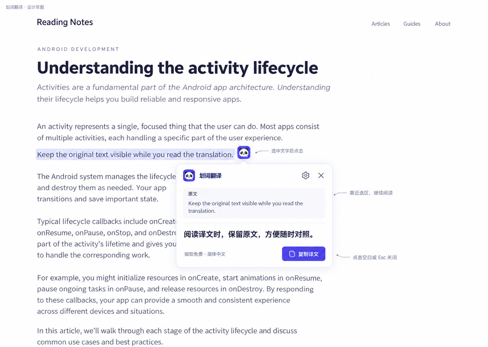
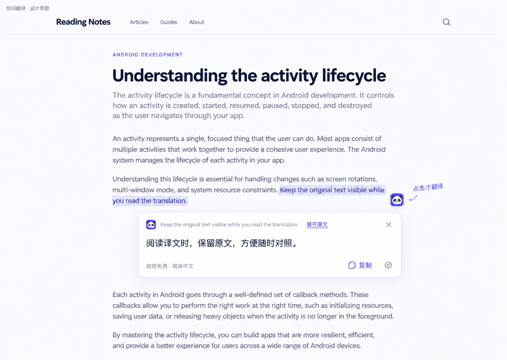
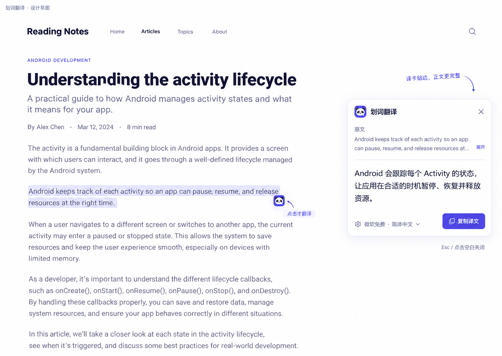

# 划词翻译：需求与设计草图

日期：2026-11-02。状态：**需求提案与静态草图，尚未实现**。本次插件更新只包含字幕位置调整和使用教程；划词功能待用户选择设计方向后再开发。

## 目标与推荐流程

让用户在阅读普通网页时，快速理解一个词、一句话或一小段文字，并继续留在原文所在页面。

推荐流程：**选中文字 → 出现小熊猫按钮 → 点击按钮 → 在当前页面查看译文**。选中本身只显示轻提示；点击才发送所选纯文本。沿用插件现有熊猫 Logo、靛蓝主色、浅紫白配色和翻译配置。

默认提供划词小按钮；设置与工具栏弹窗中可关闭“划词翻译”。这是本提案的默认值，可在评审时调整。

## 首版范围

| 项目 | 提案 |
|---|---|
| 页面 | 桌面 Chrome / Edge 的普通 HTTP/HTTPS 顶层网页 |
| 内容 | 可选的单词、短语、句子或小段落，去除首尾空白后 1–3000 字符 |
| 引擎 | 使用已保存的微软免费、谷歌免费、LibreTranslate 或 AI 配置 |
| 语言 | 源语言由引擎识别，目标语言使用当前简体中文／英文设置 |
| 发起 | 点击选区附近的小熊猫按钮，或聚焦该按钮后按 Enter／空格 |
| 结果 | 原文预览、译文、复制译文、关闭；错误时才显示重试／去设置 |
| 保存 | 不保存正文、译文或查词历史；复制只在用户点击时执行 |

首版不包含词典聚合、词性音标、朗读、聊天、收藏、历史、截图 OCR、自动替换网页文字、输入框翻译。PDF、图片内文字、浏览器内部页、其他扩展页和 iframe 划词暂不承诺支持。PDF 后续应单独适配文本层，不能以原稿 canvas 已能显示为依据直接承诺划词可用。

## 交互与界面

1. 用户完成选区后，在选区附近显示约 28×28px 的小熊猫按钮，与文字保留约 8px 距离，不盖住所选内容。
2. 点击时冻结所选文字快照，打开一张卡片。点击导致原生选区收起，也不能丢失待翻译内容。
3. 同时只显示一个按钮或一张卡片。新选区收起旧结果，只显示新按钮，仍须再次点击才翻译。
4. 推荐浮卡宽约 340–380px，边角约 12px；正文与译文采用 14–16px 的可读字号。原文默认最多两行，可展开；长译文在卡片内部滚动。
5. 卡片保留原文、译文、“复制译文”、关闭和轻量设置入口。底部只显示“当前引擎 · 目标语言”，点击设置进入现有设置页；不在卡片内重复放密钥表单或新增词典列表。
6. 点击页面空白、按 Esc、页面导航、原选区失效时关闭卡片并取消本次划词任务。页面外部滚动时收起；卡片内部的滚动、复制和选字不触发新请求。
7. 接近视口边缘时自动向上／向左避让，保证按钮和卡片可见；窗口变窄时限制宽度，不撑开原网页布局。

## 状态与反馈

| 状态 | 显示与操作 |
|---|---|
| 未选字 | 不显示划词 UI |
| 已选字 | 仅显示小熊猫按钮，不发送文本 |
| 翻译中 | 显示原文预览和“正在翻译…”，保留关闭入口 |
| 成功 | 显示译文；点击“复制译文”后给出短暂的“已复制”反馈 |
| 网络／服务失败 | 一句简明原因和“重试”；原文保留，不能显示上一段旧译文 |
| 未配置 | 提示配置当前引擎，提供“去设置” |
| 超过 3000 字符 | 提示缩小选区，不静默截断、不自动翻译整页 |
| 新选区／关闭／跳转 | 撤销旧任务，迟到回复不得重新弹出或覆盖新结果 |

## 数据与已有功能的协调

- 只发送用户明确点击的所选纯文本，不上传整页 HTML、Cookie、周围未选段落或表单值。
- 输入框、密码框、可编辑区域和插件自身 UI 中的选区不触发；选区跨过这些区域时也不读取，不能只检查选区起点。
- 已注入的网页译文、划词卡片与播放器 UI 不再次触发划词，避免套娃和重复请求。
- 划词关闭、失败或取消，不得打断整页翻译、PDF 阅读或持续字幕。修改全局引擎与目标语言时，沿用现有统一清理行为。
- 现有后台会话按标签页唯一分配，新任务会取消该标签页原任务。正式开发前必须给划词增加独立用途的会话与取消通道；不能直接复用当前 `IT_START_SESSION` 而声称互不干扰。
- 继续使用后台保存的配置和无密钥公开配置，不把服务密钥交给网页内容脚本。

## 三种布局草图

显示顺序与本次聊天中生成的图片一致。三张均为内置图像生成工具制作的静态概念，示例文章及译文用于说明布局，不代表功能已上线。

### 1. 随选浮卡（推荐）

卡片靠近选区，原文与译文上下对照，易于发现与核对。占位适中，通用性最好；卡片会暂时覆盖少量后续正文。

### 2. 极简快译条

优先显示译文，原文压缩为可展开预览，适合短句与高频轻量查询。占位更少；长段落的原文核对需要展开。

### 3. 贴边阅读卡

译卡贴近视口右侧，尽量避开正文，适合较长结果。查看结果时视线移动更远，窄屏仍需自动避让。

草图中的尺寸、图标细节与示例文字属于视觉讨论；实际交互、范围和数据流以本需求为准。生成提示词见 [prompts.txt](../../designs/selection/prompts.txt)。

## 参考依据

- [DeepL 浏览器扩展使用说明](https://support.deepl.com/hc/en-us/articles/4407580229522-Translate-with-the-browser-extensions)：参考选中文字后点击浮动图标，再查看结果的明确触发流程。
- [沉浸式翻译划词功能介绍](https://immersivetranslate.com/blog/select-and-translate-launch/)：参考小图标／轻提示与靠近阅读位置的反馈，首版采用显式点击。
- [沙拉查词使用方式](https://saladict.crimx.com/manual)：参考浮动面板的就近查看与关闭操作；不搬入其多词典、历史与情境模式。

## 验收重点（后续开发时执行）

- 选中、复制或悬停均不发送请求，点击后仅发送选区快照。
- 输入与可编辑内容不被采集；过长、跨禁区和失效选区可解释地拒绝。
- 双语网页或 YouTube 字幕翻译开启时，划词开关、重试与关闭不会使其任务失效。
- 旧响应、重复点击、新选区、配置变化和导航均不会造成错位或串文。
- 复制、键盘操作、视口边缘、长文本与页面滚动可正常使用。

下一步：用户选择布局并提出调整意见，再补充实施计划和功能代码。
